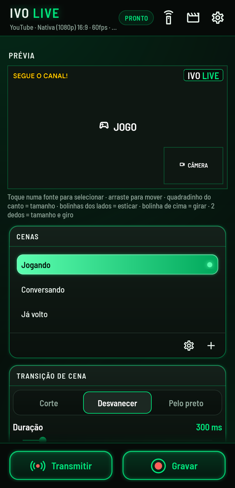
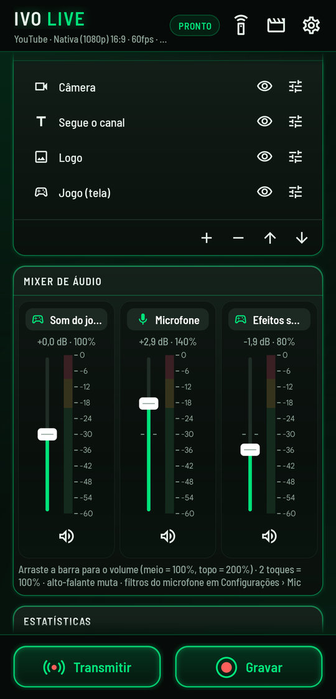
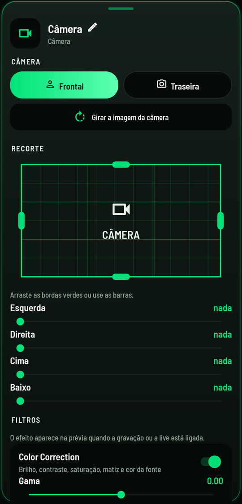
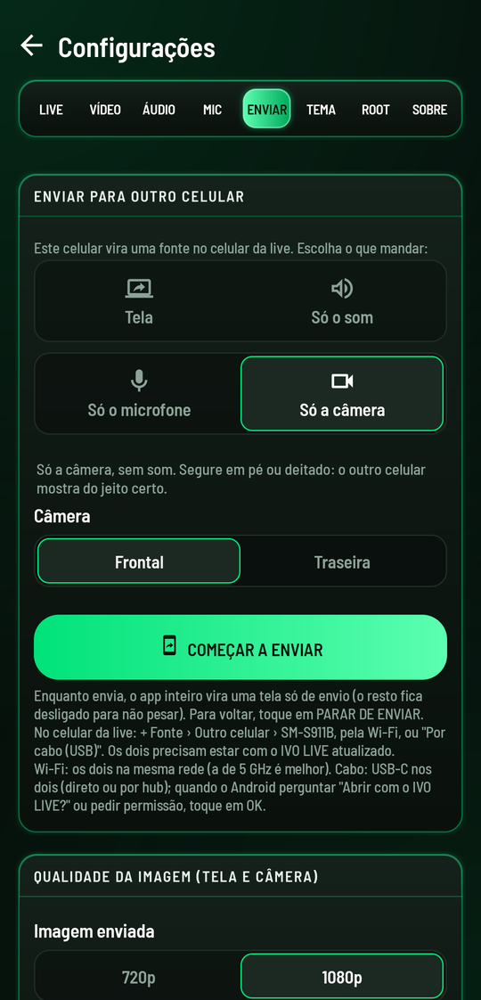
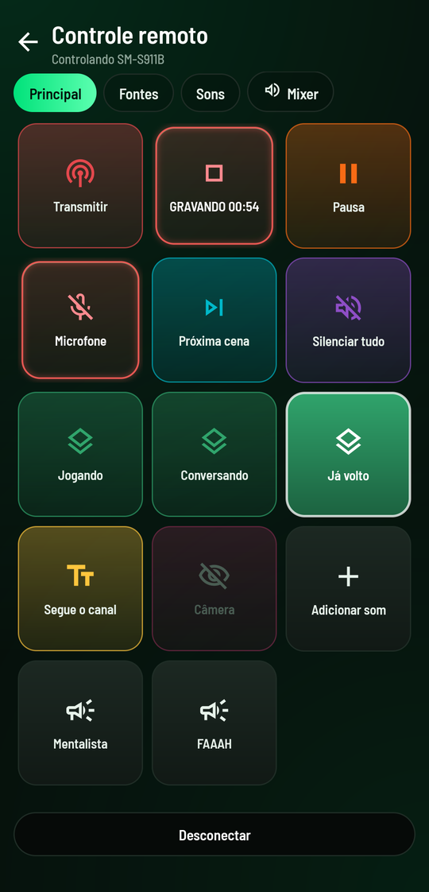
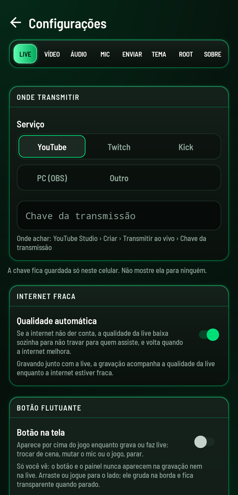

<h3 align="center"><a href="https://github.com/evilgreenIvo/ivo-live/releases/latest">⬇️ Baixar a versão mais nova</a></h3>

Grátis · sem anúncios · sem conta · Android 10 ou mais novo

---

O **IVO LIVE** transforma o celular num estúdio de transmissão: você monta **cenas** com o jogo, a sua câmera, imagens, textos e alertas, mistura o som e **grava** ou faz **live** no YouTube, Twitch ou Kick, tudo do próprio celular. É a ideia do OBS do PC, feita para o Android, em português.

<table align="center"><tr><td align="center"> Cenas e prévia</td><td align="center"> Controle remoto mostrando a live</td><td align="center"> Fontes e mixer</td></tr></table>

## Índice

- [Gravar e fazer live](#-gravar-e-fazer-live)
- [Cenas e fontes](#-cenas-e-fontes)
- [Filtros](#-filtros)
- [Som: mixer e IA no microfone](#-som-mixer-e-ia-no-microfone)
- [Outro celular como fonte](#-outro-celular-como-fonte)
- [Câmera com efeitos de fundo](#-câmera-com-efeitos-de-fundo)
- [Controle remoto estilo Stream Deck](#-controle-remoto-estilo-stream-deck)
- [Efeitos sonoros](#-efeitos-sonoros)
- [Desempenho e estatísticas](#-desempenho-e-estatísticas)
- [Mais coisas](#-mais-coisas)
- [Configurações](#configurações)
- [Como instalar](#como-instalar)
- [Privacidade](#privacidade)
- [Quem ajuda a testar](#-quem-ajuda-a-testar)

---

## 🔴 Gravar e fazer live

- **Live no YouTube, Twitch e Kick**: é só colar a chave de transmissão. Também manda para um **servidor seu** (RTMP ou SRT) ou para o **OBS do PC** pela rede de casa.
- **Gravar e fazer live ao mesmo tempo**, com botões separados: dá para parar a live e continuar gravando, ou o contrário.
- **Qualidade**: de 720p a 1440p, 30 ou 60 quadros por segundo, H.264 ou H.265. Nos celulares que aguentam, grava em **120 fps**.
- **Qualidade automática na live**: se a internet fica fraca, o app baixa a qualidade sozinho para a live não travar, e sobe de novo quando a internet melhora.
- **Ritmo de quadros certinho**: cada quadro sai no tempo exato, então o vídeo não fica tremido nem acelerado.
- **Formatos de vídeo**: deitado (16:9, 4:3), quadrado (1:1) ou em pé (3:4, 9:16, para Shorts, Reels e TikTok).
- **Botão no painel de atalhos** do Android: grava com um toque, sem abrir o app.
- **Botão flutuante** por cima do jogo, para trocar de cena e ver o tempo sem sair da partida.
- **Tela de Gravações**: seus vídeos com miniatura, duração e tamanho, para assistir, compartilhar ou apagar (um ou vários de uma vez).

## 🎬 Cenas e fontes

<table align="center"><tr><td align="center"> Prévia com jogo, câmera, logo e texto</td><td align="center"> Ajustes de uma fonte: câmera e recorte</td></tr></table>

Uma **cena** é uma montagem da tela: por exemplo "Jogando" (jogo + câmera no canto), "Já volto" (imagem + texto) e "Conversando" (câmera grande). Na live, você troca de cena com um toque.

Cada cena tem as suas **fontes**:

| Fonte | O que é |
|---|---|
| 🎮 **Jogo (tela)** | A tela do celular, com o jogo que estiver aberto |
| 📷 **Câmera** | A câmera frontal ou a traseira do próprio celular |
| 🖼️ **Imagem** | Logo, moldura, fundo, overlay |
| 🔤 **Texto** | Avisos, placar, "Já volto", com contorno para ler em cima de qualquer jogo |
| 🎨 **Cor** | Um bloco de cor (faixas, fundos) |
| 🌐 **Navegador** | Uma página da web: alertas de doação e inscrição, chat, contador |
| 📱 **Outro celular** | A tela, a câmera ou o som de outro celular (veja abaixo) |
| ⏱️ **Medidor de FPS** | Os quadros por segundo do jogo na tela (celular com root ou Shizuku) |

Na **prévia**, você arrasta, muda o tamanho com o canto ou com dois dedos, **gira** em qualquer ângulo e **recorta** as bordas. As fontes "grudam" nas bordas e no centro com um toquezinho de vibração. Dá para mudar a ordem (quem fica por cima), esconder e mostrar.

As **transições** entre cenas podem ser corte seco, esmaecer ou passar pelo preto, com a duração que você quiser.

## ✨ Filtros

<table align="center"><tr><td align="center"> Correção de cor numa fonte</td></tr></table>

Iguais aos do OBS, em qualquer fonte, e mais de um ao mesmo tempo:

- **Color Key**: tira uma cor (tela verde ou azul), com similaridade, suavidade, opacidade, contraste, brilho e gama.
- **Luma Key**: tira as partes escuras ou claras (ótimo para overlays com fundo preto).
- **Correção de cor**: brilho, contraste, saturação, matiz, gama, multiplicar e somar cor.
- **Nitidez**: deixa a imagem mais definida.

Os filtros rodam na placa de vídeo do celular, junto com o desenho da cena, então quase não pesam.

## 🎚️ Som: mixer e IA no microfone

<table align="center"><tr><td align="center"> Mixer com medidores</td><td align="center"> Redução de ruído com IA</td></tr></table>

- **Mixer** com uma barra para cada som: **jogo**, **microfone**, **cada celular** que manda som e os **efeitos sonoros**. Cada um tem volume (até 200%), mudo e medidor.
- **Cada cena guarda os seus volumes**. Por exemplo, na cena "Já volto" o jogo fica mudo e a música toca.
- **Redução de ruído com IA** no microfone: tira ventilador, teclado, ar-condicionado e barulho da rua, e deixa só a sua voz. Tem três forças (Suave, Média e Máxima) e uma versão leve para celulares mais simples.
- **Portão de ruído** com botão de **calibrar**: você fica 3 segundos em silêncio e 3 falando, e o app acha o ponto certo sozinho.
- **Limitador**, para o som não estourar nos gritos.
- O som do jogo é capturado direto, sem passar pelo microfone.

## 📱 Outro celular como fonte

<table align="center"><tr><td align="center"> No celular que manda: tela, som, microfone ou câmera</td></tr></table>

Um segundo celular vira uma câmera ou uma tela extra da sua live, **sem fio** pela rede Wi-Fi ou **por cabo** USB:

- **Tela**: joga num celular e transmite pelo outro, para o celular do jogo ficar leve. Dá para mandar o som junto ou não.
- **Câmera**: um celular velho vira a sua webcam (frontal ou traseira).
- **Som do celular** ou **microfone**: só o áudio.

O celular da live acha os outros sozinho na rede. A imagem chega em 1080p a 60 fps e cada celular ganha a sua própria barra no mixer.

## 🧑 Câmera com efeitos de fundo

Quando um celular manda a câmera (Enviar › Câmera), ele mesmo aplica os efeitos antes de enviar:

- **Desfocar fundo**: você nítido e o fundo borrado.
- **Fundo com imagem**: troca o seu quarto por uma imagem que você escolher.
- **Sem fundo**: só você aparece, recortado por cima do jogo (como uma tela verde, mas sem tela verde).
- **Seguir rosto**: a câmera acompanha o seu rosto com zoom e movimento suaves, e você continua no centro mesmo se mexendo.

Tudo isso é feito por IA no próprio celular, sem internet.

## 🎛️ Controle remoto estilo Stream Deck

<table align="center"><tr><td align="center"> Gravando, com a imagem da live</td><td align="center"> Botões coloridos, do seu jeito</td><td align="center"> Página do mixer</td></tr></table>

Um segundo celular vira um **painel de botões grandes** para controlar a live, como um Stream Deck:

- **Transmitir** e **Gravar** (para parar, ele pede confirmação, para não derrubar a live sem querer).
- Um botão para **cada cena** e para **mostrar ou esconder cada fonte**.
- **Pausa**: vai para a cena "Já volto" e muta o microfone num toque. Toque de novo e tudo volta.
- **Próxima cena**, **Silenciar tudo** e **mudo** de cada som.
- **Editar textos** da tela (placar, aviso, meta) sem encostar no celular da live.
- **Ver a live**: uma telinha mostra a imagem que está saindo para o público.
- Página de **mixer** com o volume de cada som.
- **Você monta o painel**: escolhe o que cada botão faz, o nome, a **cor** e o lugar, e separa em **páginas**, quantas quiser.

Os dois celulares só precisam estar no mesmo Wi-Fi. O celular da live mostra um código de 4 números, e o outro digita uma vez só.

## 📢 Efeitos sonoros

No controle remoto, toque em **Adicionar som**: abre o site **MyInstants** dentro do app. Você ouve os sons, toca em "Adicionar" e cada um vira um botão do painel, **quantos quiser**. Os sons entram **direto na live e na gravação**, com volume próprio no mixer.

## 📊 Desempenho e estatísticas

- **Teste do celular** na primeira abertura: o app mede o seu aparelho (processador, memória, codificador de vídeo, IA) e já sugere a melhor qualidade.
- **Estatísticas** ao vivo: FPS, quadros perdidos, velocidade da internet, uso de CPU e GPU, memória, bateria e temperatura. Uma linha em português diz qual é o problema, se tiver algum.
- **Relatório de desempenho** de cada gravação ou live, com um veredito em palavras.
- **Funções extras para celular com root**: gravar sem a pergunta do Android, proteger o app de ser fechado e segurar os serviços do Google enquanto você grava.

## 🧩 Mais coisas

- A tela **se adapta**: celular em pé, deitado, tablet ou monitor (no modo deitado em tela grande, fica com painéis como o OBS).
- **Temas de cor**, animação de abertura e visual escuro.
- Funciona com **mouse** (no DeX ou num monitor): clique direito abre menus e a rodinha muda o tamanho das fontes.
- Em **português, inglês e espanhol**, seguindo o idioma do celular.
- **Avisa quando sai versão nova**, mostra o que mudou e instala com um toque.
- **Relatório de erro** com um toque, para ajudar a corrigir problemas.

---

## Configurações

<table align="center"><tr><td align="center"> Onde transmitir e qualidade automática</td></tr></table>

## Como instalar

1. Baixe o arquivo `.apk` na [página de versões](https://github.com/evilgreenIvo/ivo-live/releases/latest).
2. Abra o arquivo. Se o Android pedir, permita "instalar apps desta fonte".
3. Para atualizar, o próprio app avisa quando sair versão nova. Ou baixe aqui e instale por cima: suas cenas e configurações continuam.

## Privacidade

- O app **não tem conta, anúncios nem rastreamento**.
- Gravações, cenas e chaves de live ficam **só no seu celular**.
- O relatório de erro só sai do celular se **você** tocar em Enviar no e-mail, e ele **não leva** sua chave de live, senhas, fotos nem vídeos.
- O app só consulta esta página para saber se tem versão nova. Ele não manda nada sobre você.

## 🙌 Quem ajuda a testar

O IVO LIVE fica melhor a cada versão graças a quem usa de verdade, em live, e manda os relatórios de erro. Muito obrigado!

<table>
<tr>
<td align="center" width="140"><a href="https://github.com/Dantiano"> <b>Dantiano</b></a></td>
<td>Testa o app nas suas lives de jogos com vários celulares (Galaxy S20 FE enviando a tela e a câmera para o celular da live), descobre problemas antes de todo mundo e manda os relatórios que viraram várias correções, como o espelhamento que caía e o contorno verde do Sem fundo.  
📺 <a href="https://www.youtube.com/@Dantiano">youtube.com/@Dantiano</a> · 💻 <a href="https://github.com/Dantiano">github.com/Dantiano</a></td>
</tr>
</table>

## Encontrou um problema?

No app: **Configurações › Sobre › Enviar relatório agora**. Ou abra uma [issue aqui](https://github.com/evilgreenIvo/ivo-live/issues).

---

O IVO LIVE usa partes feitas por outras pessoas, com licenças que permitem isso. Os créditos estão em [NOTICE.md](NOTICE.md). "OBS" e "Stream Deck" são marcas dos seus donos. O IVO LIVE não tem ligação com eles.
