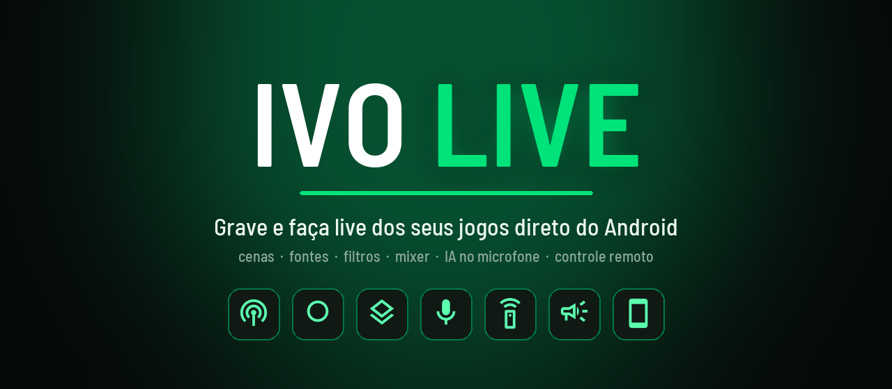
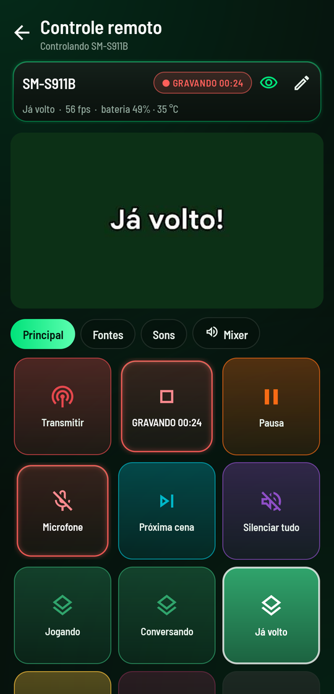
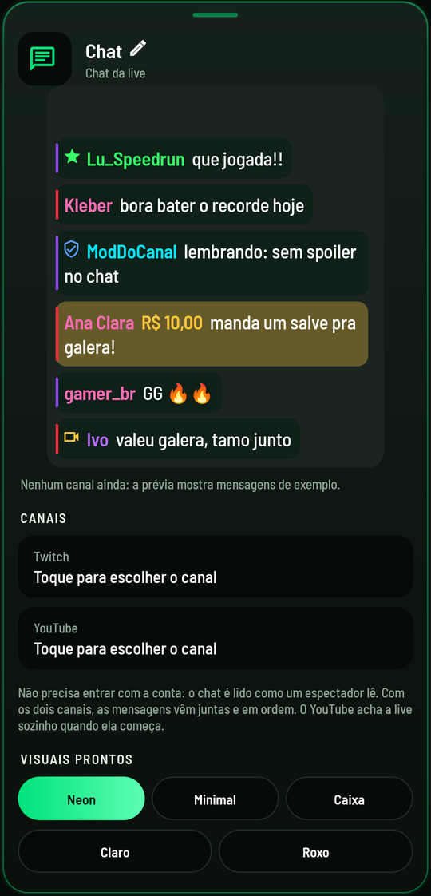
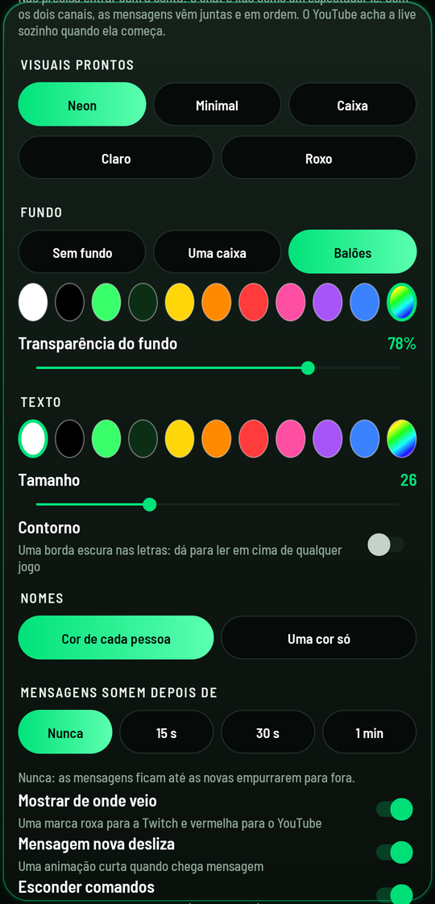
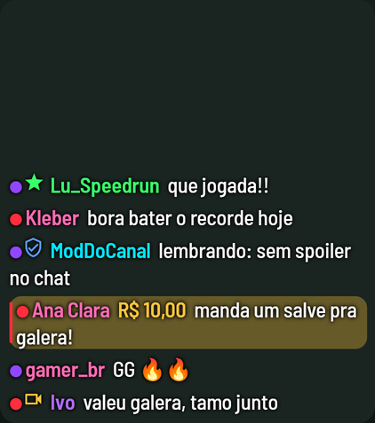
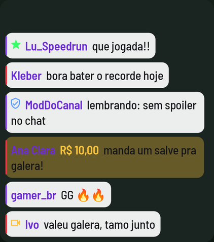
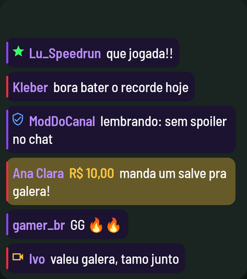
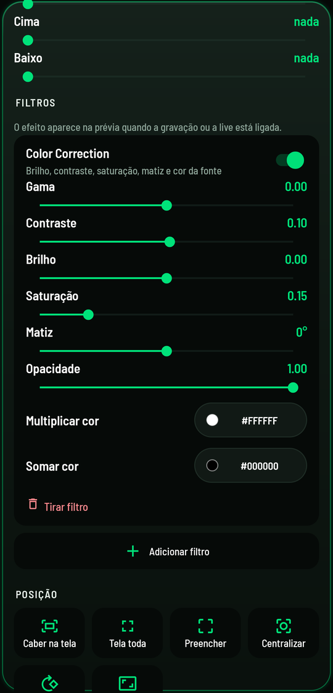
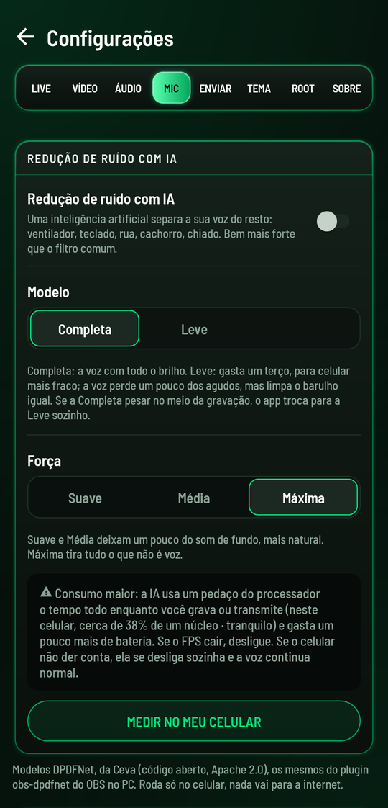
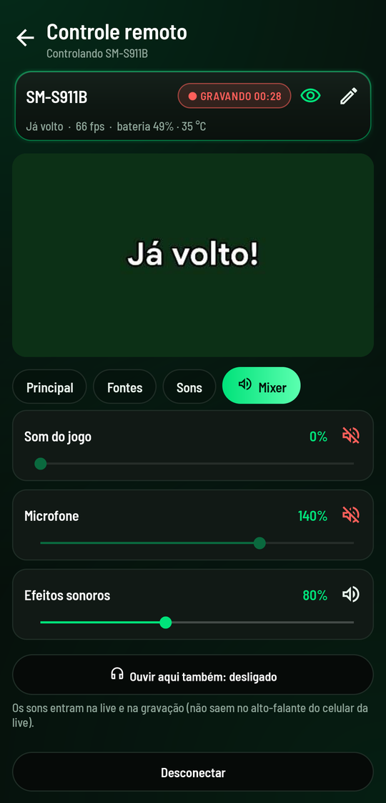

  
  
  
  

<h3 align="center"><a href="https://github.com/evilgreenIvo/ivo-live/releases/latest">⬇️ Baixar a versão mais nova</a></h3>

<b>⏳ Teste agora 100% grátis.</b> Algumas funções vão ser pagas no futuro: aproveite enquanto está tudo liberado. Sem anúncios · sem conta · em português, inglês e espanhol

---

O **IVO LIVE** transforma o celular num estúdio de transmissão: você monta **cenas** com o jogo, a sua câmera, imagens, textos e alertas, mistura o som e **grava** ou faz **live** no YouTube, Twitch ou Kick, tudo do próprio celular. É a ideia do OBS do PC, feita para o Android, em português.

> [!TIP]
> **Novidades da 0.54.0: deitado e em pé ao mesmo tempo**
> - **Vídeo em pé junto**: enquanto grava deitado (16:9), o app grava junto um vídeo em pé 9:16 para Shorts, Reels e TikTok, com as mesmas cenas e o mesmo som. Cada fonte tem o seu lugar, a sua Perspectiva 3D e os seus filtros em cada vídeo.
> - **Live dupla**: uma live deitada e uma em pé ao mesmo tempo (YouTube, Twitch, Kick ou rtmp://). No YouTube dá para entrar com a conta e o app cria as duas lives no canal sozinho (por enquanto só para testadores, até o Google aprovar).
> - **Fonte Vídeo ou GIF** com repetição sem parar, **Salvar e abrir cenas** num arquivo e o tema de chat **Cartões**, com a foto de quem comenta.
> - **0.54.2:** avatar mais fluido (expressões se dissolvem, sem pulo e sem piscar de luz) e estilo no Criar com IA: manter, desenho/cartoon ou anime (dá para virar personagem a partir de uma foto sua).
> - Também nas últimas versões: Avatar (PNGtuber) com IA, filtro Sombra e o avatar seguindo a sua cabeça.
>
> [Ver todas as versões e o que mudou em cada uma](https://github.com/evilgreenIvo/ivo-live/releases)

> [!WARNING]
> **Vídeo e live dupla não são para qualquer celular.** Fazer os dois vídeos ao mesmo tempo é pesado: é para celulares topo de linha (Galaxy S22/S23 ou melhor, Snapdragon 8 Gen 1 ou mais novo), de preferência com cooler, e para a live dupla uma internet que aguente mandar as duas juntas. Em celulares mais simples pode esquentar, perder quadros ou cortar o som: use um vídeo de cada vez.

<table align="center"><tr><td align="center"> Cenas e prévia</td><td align="center"> Controle remoto mostrando a live</td><td align="center"> Fontes e mixer</td></tr></table>

## Índice

- [Gravar e fazer live](#-gravar-e-fazer-live)
- [Cenas e fontes](#-cenas-e-fontes)
- [Avatar (PNGtuber)](#-avatar-pngtuber)
- [Chat da live](#-chat-da-live)
- [Cronômetro de speedrun](#-cronômetro-de-speedrun)
- [Filtros](#-filtros)
- [Som: mixer e IA no microfone](#-som-mixer-e-ia-no-microfone)
- [Outro celular como fonte](#-outro-celular-como-fonte)
- [Tela do iPhone na live](#-tela-do-iphone-na-live)
- [Câmera com efeitos de fundo](#-câmera-com-efeitos-de-fundo)
- [Controle remoto estilo Stream Deck](#-controle-remoto-estilo-stream-deck)
- [Efeitos sonoros](#-efeitos-sonoros)
- [Desempenho e estatísticas](#-desempenho-e-estatísticas)
- [Mais coisas](#-mais-coisas)
- [Configurações](#configurações)
- [Como instalar](#como-instalar)
- [Privacidade](#privacidade)

---

## 🔴 Gravar e fazer live

- **Live no YouTube, Twitch e Kick**: é só colar a chave de transmissão. Também manda para um **servidor seu** (RTMP ou SRT) ou para o **OBS do PC** pela rede de casa.
- **Gravar e fazer live ao mesmo tempo**, com botões separados: dá para parar a live e continuar gravando, ou o contrário.
- **Qualidade**: de 720p a 1440p, 30 ou 60 quadros por segundo, H.264 ou H.265. Nos celulares que aguentam, grava em **120 fps**.
- **Qualidade automática na live**: se a internet fica fraca, o app baixa a qualidade sozinho para a live não travar, e sobe de novo quando a internet melhora.
- **Ritmo de quadros certinho**: cada quadro sai no tempo exato, então o vídeo não fica tremido nem acelerado.
- **Formatos de vídeo**: deitado (16:9, 4:3), quadrado (1:1) ou em pé (3:4, 9:16, para Shorts, Reels e TikTok).
- **Deitado e em pé ao mesmo tempo** (celulares topo de linha): grava e faz live com um segundo vídeo em pé 9:16, arrumado à parte com a chave Deitado | Em pé em cima da prévia. Cada fonte pode aparecer nos dois ou só num deles.
- **Botão no painel de atalhos** do Android: grava com um toque, sem abrir o app.
- **Botão flutuante** por cima do jogo, para trocar de cena e ver o tempo sem sair da partida.
- **Tela de Gravações**: seus vídeos com miniatura, duração e tamanho, para assistir, compartilhar ou apagar (um ou vários de uma vez).

## 🎬 Cenas e fontes

<table align="center"><tr><td align="center"> Prévia com jogo, câmera, logo e texto</td><td align="center"> Ajustes de uma fonte: câmera e recorte</td></tr></table>

Uma **cena** é uma montagem da tela: por exemplo "Jogando" (jogo + câmera no canto), "Já volto" (imagem + texto) e "Conversando" (câmera grande). Na live, você troca de cena com um toque.

Cada cena tem as suas **fontes**:

| Fonte | O que é |
|---|---|
| 🎮 **Jogo (tela)** | A tela do celular, com o jogo que estiver aberto |
| 📷 **Câmera** | A câmera frontal ou a traseira do próprio celular |
| 🖼️ **Imagem** | Logo, moldura, fundo, overlay |
| 🧑‍🎤 **Avatar** | O seu personagem (PNGtuber), que fala e reage junto com a sua voz (veja abaixo) |
| 🔤 **Texto** | Avisos, placar, "Já volto", com contorno para ler em cima de qualquer jogo |
| 🎨 **Cor** | Um bloco de cor (faixas, fundos) |
| 💬 **Chat da live** | O chat da Twitch e do YouTube na tela, com as suas cores (veja abaixo) |
| 🏁 **Cronômetro de speedrun** | Tempo e trechos da corrida, como o LiveSplit (veja abaixo) |
| 🌐 **Navegador** | Uma página da web: alertas de doação e inscrição, contador |
| 📱 **Outro celular** | A tela, a câmera ou o som de outro celular (veja abaixo) |
| ⏱️ **Medidor de FPS** | Os quadros por segundo do jogo na tela (celular com root ou Shizuku) |

Na **prévia**, você arrasta, muda o tamanho com o canto ou com dois dedos, **gira** em qualquer ângulo, vira em **3D (perspectiva)** e **recorta** arrastando as bordas. As fontes "grudam" nas bordas e no centro com um toquezinho de vibração.

- No celular, as **cenas viram botões** lado a lado: um toque troca, segurar abre as opções.
- **Segure o ≡** ao lado de uma fonte e arraste para mudar a ordem (quem fica por cima).
- **Cadeado**: trava uma fonte no lugar, para um toque sem querer na prévia não mexer nela.
- O **painel da fonte** abre sem cobrir a prévia, então cada ajuste aparece na hora.

As **transições** entre cenas podem ser corte seco, esmaecer ou passar pelo preto, com a duração que você quiser.

## 🧑‍🎤 Avatar (PNGtuber)

Um personagem seu na tela, por cima do jogo, que **fala junto com você**. Leve, sem 3D e sem câmera: ele reage ao seu microfone.

- **Fala e se mexe com a voz**: troca a boca (A, E, O), pula e estica quando você fala, pisca sozinho, fica mais escuro quando você está calado, **dorme** depois de 30 segundos em silêncio e faz **cara de surpreso** num grito.
- **Reações num toque**: Feliz, Rindo, Surpreso, Bravo ou Triste por 5 segundos, pelo painel do Avatar ou pelo **botão flutuante** sem sair do jogo.
- **Criar com IA, em 3 passos**:
  1. Escolha uma imagem do seu personagem (um desenho, um personagem ou uma foto sua), ou descreva como ele é.
  2. Toque em **Abrir no ChatGPT**: o pedido e a imagem já vão prontos, é só enviar. Também funciona no **Flow do Google**.
  3. Volte e escolha a imagem gerada. O app **tira o fundo, separa e alinha** cada expressão sozinho, e cola só a boca e os olhos sobre a cara neutra, para o corpo nunca pular.
- **Folha extra** (opcional): mais 5 expressões, feitas a partir da cara do seu próprio avatar, para chegar a **11 expressões** no total.
- **Sem IA também**: use uma imagem só ou uma imagem para cada expressão. Um fundo de cor lisa sai sozinho.
- No painel: o avatar se mexendo **ao vivo**, a **sensibilidade da voz** com um medidor para testar antes da live e o quanto ele se mexe (**Sutil, Normal ou Exagerado**).

Tudo roda no próprio celular. Na live, ele usa o mesmo microfone da transmissão, sem pesar.

## 💬 Chat da live

<table align="center"><tr><td align="center"> Painel do chat com a prévia</td><td align="center"> Fundo, cores, tamanho e nomes</td></tr></table>

O próprio app lê o chat e desenha na tela, sem abrir página da internet (fica bem mais leve).

- **Twitch e YouTube, sem login**: é só escrever o canal. Com os dois, as mensagens vêm juntas e em ordem. O YouTube acha a live sozinho quando ela começa.
- **Visuais prontos**: Neon, Minimal, Caixa, Claro e Roxo. Um toque e já fica bonito.
- **Do seu jeito**: fundo transparente, uma caixa ou balões, cor e transparência do fundo, cor e tamanho do texto, contorno, cor dos nomes (a de cada pessoa ou uma só), mensagens que somem depois de um tempo e animação de entrada.
- **Detalhes**: emotes da Twitch, emojis do YouTube, Super Chat e bits em destaque, marca de dono, moderador e membro, e opção de esconder comandos (!sorteio) e robôs.
- **Prévia na hora** no painel, já com as mensagens de verdade. A letra cresce junto quando você aumenta a caixa.
- **No controle remoto**: um botão Chat abre o chat grande para você ler durante a live.

<table align="center"><tr><td align="center"> Neon</td><td align="center"> Minimal</td><td align="center"> Claro</td><td align="center"> Roxo</td></tr></table>

Ainda dá para usar o link de chat do Restream ou do Streamlabs, pelo painel da fonte.

## 🏁 Cronômetro de speedrun

- Escreva os **trechos** da corrida (um por linha) e marque cada **split**.
- **Verde** quando você está na frente do seu recorde, **vermelho** quando está atrás, **dourado** no recorde novo. Cada lista de trechos guarda o seu recorde.
- Começar, split, pausar, desfazer e zerar pelo painel da fonte, pelo **botão flutuante** (sem sair do jogo) e pelo **controle remoto** (um botão só que abre todas as funções).

## ✨ Filtros

<table align="center"><tr><td align="center"> Correção de cor numa fonte</td></tr></table>

Iguais aos do OBS, em qualquer fonte, e mais de um ao mesmo tempo:

- **Color Key**: tira uma cor (tela verde ou azul), com similaridade, suavidade, opacidade, contraste, brilho e gama.
- **Luma Key**: tira as partes escuras ou claras (ótimo para overlays com fundo preto).
- **Correção de cor**: brilho, contraste, saturação, matiz, gama, multiplicar e somar cor.
- **Nitidez**: deixa a imagem mais definida.

Os filtros rodam na placa de vídeo do celular, junto com o desenho da cena, então quase não pesam.

## 🎚️ Som: mixer e IA no microfone

<table align="center"><tr><td align="center"> Mixer com medidores</td><td align="center"> Redução de ruído com IA</td></tr></table>

- **Mixer** com uma barra para cada som: **jogo**, **microfone**, **cada celular** que manda som e os **efeitos sonoros**. Cada um tem volume (até 200%), mudo e medidor.
- **Cada cena guarda os seus volumes**. Por exemplo, na cena "Já volto" o jogo fica mudo e a música toca.
- **Redução de ruído com IA** no microfone: tira ventilador, teclado, ar-condicionado e barulho da rua, e deixa só a sua voz. Tem três forças (Suave, Média e Máxima) e uma versão leve para celulares mais simples.
- **Portão de ruído** com botão de **calibrar**: você fica 3 segundos em silêncio e 3 falando, e o app acha o ponto certo sozinho.
- **Limitador**, para o som não estourar nos gritos.
- O som do jogo é capturado direto, sem passar pelo microfone.

## 📱 Outro celular como fonte

<table align="center"><tr><td align="center"> No celular que manda: tela, som, microfone ou câmera</td></tr></table>

Um segundo celular vira uma câmera ou uma tela extra da sua live, **sem fio** pela rede Wi-Fi ou **por cabo** USB:

- **Tela**: joga num celular e transmite pelo outro, para o celular do jogo ficar leve. Dá para mandar o som junto ou não.
- **Câmera**: um celular velho vira a sua webcam (frontal ou traseira).
- **Som do celular** ou **microfone**: só o áudio.

O celular da live acha os outros sozinho na rede. A imagem chega em 1080p a 60 fps e cada celular ganha a sua própria barra no mixer.

## 🍎 Tela do iPhone na live

Quer jogar no iPhone e fazer a live pelo Android? O app irmão **[IVO Mirror](https://github.com/evilgreenIvo/ivo-mirror)** recebe a tela do iPhone pelo **Espelhamento de Tela** (o mesmo botão que manda a tela para uma TV) e entrega para o IVO LIVE como a fonte **Outro celular**, com imagem e som. Grátis e de código aberto.

## 🧑 Câmera com efeitos de fundo

Quando um celular manda a câmera (Enviar › Câmera), ele mesmo aplica os efeitos antes de enviar:

- **Desfocar fundo**: você nítido e o fundo borrado.
- **Fundo com imagem**: troca o seu quarto por uma imagem que você escolher.
- **Sem fundo**: só você aparece, recortado por cima do jogo (como uma tela verde, mas sem tela verde).
- **Seguir rosto**: a câmera acompanha o seu rosto com zoom e movimento suaves, e você continua no centro mesmo se mexendo.

Tudo isso é feito por IA no próprio celular, sem internet.

## 🎛️ Controle remoto estilo Stream Deck

<table align="center"><tr><td align="center"> Gravando, com a imagem da live</td><td align="center"> Botões coloridos, do seu jeito</td><td align="center"> Página do mixer</td></tr></table>

Um segundo celular vira um **painel de botões grandes** para controlar a live, como um Stream Deck:

- **Transmitir** e **Gravar** (para parar, ele pede confirmação, para não derrubar a live sem querer).
- Um botão para **cada cena** e para **mostrar ou esconder cada fonte**.
- **Pausa**: vai para a cena "Já volto" e muta o microfone num toque. Toque de novo e tudo volta.
- **Próxima cena**, **Silenciar tudo** e **mudo** de cada som.
- **Editar textos** da tela (placar, aviso, meta) sem encostar no celular da live.
- **Chat**: abre o chat da live grande, para ler durante a live. O próprio controle lê o chat, então o celular da live não faz trabalho a mais.
- **Cronômetro**: um botão que abre começar, split, pausar, desfazer e zerar.
- **Ver a live**: uma telinha mostra a imagem que está saindo para o público.
- Página de **mixer** com o volume de cada som.
- **Você monta o painel**: escolhe o que cada botão faz, o nome, a **cor** e o lugar, e separa em **páginas**, quantas quiser.

Os dois celulares só precisam estar no mesmo Wi-Fi. O celular da live mostra um código de 4 números, e o outro digita uma vez só.

## 📢 Efeitos sonoros

No controle remoto, toque em **Adicionar som**: abre o site **MyInstants** dentro do app. Você ouve os sons, toca em "Adicionar" e cada um vira um botão do painel, **quantos quiser**. Os sons entram **direto na live e na gravação**, com volume próprio no mixer.

## 📊 Desempenho e estatísticas

- **Teste do celular** na primeira abertura: o app mede o seu aparelho (processador, memória, codificador de vídeo, IA) e já sugere a melhor qualidade.
- **Estatísticas** ao vivo: FPS, quadros perdidos, velocidade da internet, uso de CPU e GPU, memória, bateria e temperatura. Uma linha em português diz qual é o problema, se tiver algum.
- **Relatório de desempenho** de cada gravação ou live, com um veredito em palavras.
- **Funções extras para celular com root**: gravar sem a pergunta do Android, proteger o app de ser fechado e segurar os serviços do Google enquanto você grava.

## 🧩 Mais coisas

- A tela **se adapta**: celular em pé, deitado, tablet ou monitor (no modo deitado em tela grande, fica com painéis como o OBS).
- **Temas de cor**, animação de abertura e visual escuro.
- Funciona com **mouse** (no DeX ou num monitor): clique direito abre menus e a rodinha muda o tamanho das fontes.
- Em **português, inglês e espanhol**, seguindo o idioma do celular.
- **Avisa quando sai versão nova**, mostra o que mudou e instala com um toque.
- **Relatório de erro** com um toque, para ajudar a corrigir problemas.

---

## Configurações

<table align="center"><tr><td align="center"> Onde transmitir e qualidade automática</td></tr></table>

## Como instalar

1. Baixe o arquivo `.apk` na [página de versões](https://github.com/evilgreenIvo/ivo-live/releases/latest).
2. Abra o arquivo. Se o Android pedir, permita "instalar apps desta fonte".
3. Para atualizar, o próprio app avisa quando sair versão nova. Ou baixe aqui e instale por cima: suas cenas e configurações continuam.

## Privacidade

- O app **não pede conta, não tem anúncios nem rastreamento**. Só a live dupla no YouTube oferece, se você quiser, **Entrar com YouTube** para o app criar as lives no seu canal; o acesso fica só no seu celular e sai quando você toca em Sair.
- Gravações, cenas e chaves de live ficam **só no seu celular**.
- O relatório de erro só sai do celular se **você** tocar em Enviar no e-mail, e ele **não leva** sua chave de live, senhas, fotos nem vídeos.
- O app só consulta esta página para saber se tem versão nova. Ele não manda nada sobre você.

## Encontrou um problema?

No app: **Configurações › Sobre › Enviar relatório agora**. Ou abra uma [issue aqui](https://github.com/evilgreenIvo/ivo-live/issues).

---

O IVO LIVE usa partes feitas por outras pessoas, com licenças que permitem isso. Os créditos estão em [NOTICE.md](NOTICE.md). "OBS", "Stream Deck", "ChatGPT", "Flow" e "iPhone" são marcas dos seus donos. O IVO LIVE não tem ligação com eles.
<b>👾 Dantiano</b>
